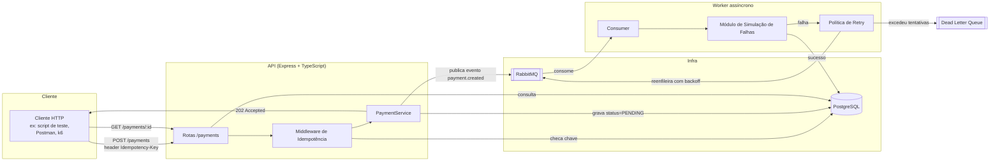
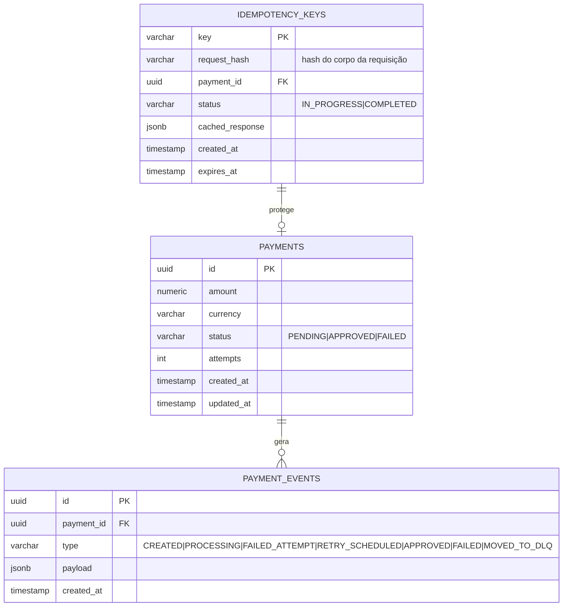

# 01 — Arquitetura do Sistema

> Referência normativa deste projeto. Qualquer decisão de design que contradiga
> este documento deve atualizá-lo, não ser feita silenciosamente ao lado dele.

## 1. Visão geral

O sistema é um **simulador de processamento de pagamentos** com duas partes que
rodam separadamente e se comunicam por fila:

1. **API HTTP (síncrona)** — recebe pedidos de criação/consulta de pagamento,
   responde rápido, delega o processamento pesado para depois.
2. **Worker (assíncrono)** — consome a fila, "processa" o pagamento (com chance
   configurável de falha simulada), aplica retry quando falha, e atualiza o status
   final no banco.



## 2. Componentes

### 2.1 API (Express + TypeScript)

Arquitetura em camadas simples — deliberadamente sem framework opinativo (ver
seção 6 sobre a escolha Express vs. NestJS):

- **Routes** — mapeiam URL/verbo HTTP para um controller. Sem lógica.
- **Controllers** — leem request, chamam o service, formatam resposta HTTP.
  Sem lógica de negócio.
- **Middlewares** — `idempotency.middleware.ts` (intercepta requests de criação e
  decide: é uma chave nova ou repetida?), tratamento de erros centralizado,
  logging com correlation ID.
- **Services** — `PaymentService`, `IdempotencyService`. Aqui mora a lógica de
  negócio. **Esta é a camada que Pedro escreve e precisa dominar de memória.**
- **Repositories** — acesso ao banco (via `pg` ou um query builder leve, ex.
  `Kysely` ou `Drizzle` — decidir na Fase 0 e registrar em `06-riscos-e-decisoes.md`).
- **Publisher** — encapsula a publicação de mensagens no RabbitMQ.

### 2.2 Worker

Processo separado (outro `node` process, ou outro container no Docker Compose) que:

1. Consome a fila `payments.process`.
2. Executa o **módulo de simulação de falhas** (`chaos/`), que decide, com base
   em uma probabilidade configurável, se essa tentativa de processamento "falha"
   (timeout simulado, exceção simulada, ou processa normalmente).
3. Em sucesso: atualiza `payments.status = APPROVED`, grava evento em
   `payment_events`, `ACK` da mensagem.
4. Em falha: aplica a **política de retry** (seção 4) — reenfileira com atraso
   crescente (backoff exponencial) até um número máximo de tentativas; depois
   disso, marca `payments.status = FAILED` e a mensagem vai para a
   **dead-letter queue**.

### 2.3 Banco de dados (PostgreSQL)



`payment_events` é o log de auditoria/eventos — além de necessário para debug e
para os experimentos (dá a linha do tempo completa de cada pagamento), ele conecta
diretamente com o conceito de **arquitetura orientada a eventos** mencionado no
referencial teórico do Projeto Final I. Vale citar isso explicitamente na seção de
Desenvolvimento do artigo final.

### 2.4 RabbitMQ — topologia de filas

- `payments.process` — fila principal, consumida pelo worker.
- `payments.retry` — fila intermediária com **TTL por mensagem**; quando o TTL
  expira, o RabbitMQ redireciona a mensagem de volta para `payments.process`
  (padrão *delayed retry via dead-letter exchange*). O TTL cresce a cada
  tentativa (backoff exponencial).
- `payments.dead-letter` (DLQ) — destino final de mensagens que excederam o
  número máximo de tentativas. Fica ali para inspeção manual — não é
  reprocessada automaticamente.

Este é o padrão "TTL + Dead Letter Exchange" para retry atrasado, comum em
RabbitMQ (não existe atraso nativo de mensagem sem essa técnica). **Explicar isso
para o Pedro antes de implementar** — é um dos pontos mais prováveis de pergunta
de banca.

## 3. Idempotência — mecanismo detalhado

1. Cliente envia `POST /payments` com header `Idempotency-Key: <uuid gerado pelo cliente>`.
2. Middleware verifica se a chave já existe em `idempotency_keys`:
   - **Não existe:** grava a chave com status `IN_PROGRESS` (dentro da mesma
     transação que cria o `payment` com status `PENDING`), publica na fila,
     responde `202 Accepted`.
   - **Existe e está `COMPLETED`:** retorna imediatamente o `cached_response`
     salvo, **sem** tocar na fila nem criar novo pagamento. Este é o
     comportamento que prova a idempotência nos experimentos.
   - **Existe e está `IN_PROGRESS`:** requisição concorrente da mesma chave —
     retornar `409 Conflict` ou `202` apontando para o pagamento já em
     processamento (decidir e documentar; é um bom ponto de discussão no artigo).
3. Unicidade da chave é garantida por `UNIQUE` constraint no banco — não por
   lógica de aplicação apenas (condição de corrida real precisa de garantia no
   nível do banco).

**Importante para os experimentos:** incluir uma flag de configuração (ex.
`IDEMPOTENCY_ENABLED=false`) que desliga esse mecanismo. Isso permite rodar o
mesmo cenário de carga com e sem idempotência e comparar os resultados
diretamente — é a evidência mais forte para responder a questão de pesquisa do
Projeto Final I. Ver `04-plano-de-experimentos.md`.

## 4. Simulação de falhas e retry — mecanismo detalhado

- Módulo `chaos/` no worker, configurável via variáveis de ambiente:
  - `FAILURE_RATE` (ex. 0.0 a 1.0) — probabilidade de uma tentativa "falhar".
  - `FAILURE_MODES` — quais tipos simular: exceção imediata, timeout (delay +
    falha), resposta de "gateway externo indisponível".
- Política de retry:
  - `MAX_ATTEMPTS` (ex. 3 ou 5 — decidir e justificar no artigo).
  - Backoff exponencial (ex. 1s, 4s, 16s) implementado via TTL crescente nas
    mensagens da fila `payments.retry`.
  - Cada tentativa incrementa `payments.attempts` e gera um `payment_events`
    do tipo `FAILED_ATTEMPT` ou `RETRY_SCHEDULED`.
- Ao esgotar `MAX_ATTEMPTS`: `payments.status = FAILED`, evento `MOVED_TO_DLQ`,
  mensagem original vai para `payments.dead-letter`.

## 5. Consistência — o que este sistema realmente garante

Ser explícito sobre isso no artigo é importante (conecta direto com Vogels, 2009,
já citado no referencial teórico):

- O sistema **não** oferece consistência forte imediata: entre o `202 Accepted`
  e o pagamento chegar a `APPROVED`/`FAILED`, existe uma janela onde o estado é
  `PENDING` — isto é **consistência eventual** por design, não um bug.
- O que o sistema garante de forma forte (via constraints de banco, não apenas
  "por enquanto funcionou"): nenhuma `Idempotency-Key` gera duas operações
  válidas, mesmo sob concorrência.

## 6. Stack técnica e justificativas

| Escolha | Motivo |
|---|---|
| **Node.js + TypeScript** | Decisão de Pedro (ver `06-riscos-e-decisoes.md`). Bom ecossistema para APIs + filas, tipagem ajuda a modelar os estados do pagamento explicitamente. |
| **Express** (em vez de NestJS) | NestJS traria mais estrutura "de fábrica", mas exige aprender injeção de dependência e decorators em cima de RabbitMQ + Docker + idempotência ao mesmo tempo — carga alta demais para quem está começando com 5–10h/semana. Express + uma arquitetura em camadas **explicada e documentada aqui** entrega a mesma clareza arquitetural para a banca, com menos fricção de aprendizado. *Se, depois da Fase 2, Pedro se sentir confortável e quiser migrar, é uma decisão válida — registrar em `06-riscos-e-decisoes.md` se acontecer.* |
| **PostgreSQL** | Constraints fortes (`UNIQUE`, transações) são o que de fato garante idempotência sob concorrência — não dá pra terceirizar isso para a aplicação. |
| **RabbitMQ** | Fila clássica, modelo de exchanges/DLX é didático para demonstrar retry e dead-letter visualmente (management UI do RabbitMQ ajuda muito na apresentação/banca). |
| **Docker Compose** | Sobe Postgres + RabbitMQ + API + Worker com um comando; essencial dado o nível iniciante — reduz "funciona na minha máquina". |
| **Testes** | Vitest ou Jest (decidir na Fase 0). Testes de unidade para services, teste de integração básico para o fluxo de idempotência. |
| **Carga/experimentos** | k6 ou autocannon para gerar requisições concorrentes/duplicadas de forma controlada (ver `04-plano-de-experimentos.md`). |
| **Logging** | `pino` com correlation ID por requisição — necessário para reconstruir a linha do tempo de cada pagamento nos experimentos. |

## 7. Fora de escopo (deliberadamente)

Para manter o projeto viável no prazo, os itens abaixo **não** fazem parte do
sistema, e isso deve ser mencionado no artigo como delimitação consciente, não
como lacuna:

- Integração com gateway de pagamento real (Stripe, PagSeguro etc.) — o
  "processamento" é sempre simulado.
- Autenticação/autorização de usuários (não é o foco do estudo).
- Múltiplos serviços/microsserviços adicionais — API e Worker são os dois únicos
  processos da aplicação.
- Escalonamento horizontal, múltiplas réplicas, service mesh, Kubernetes.
- Interface gráfica (frontend) — interação é via HTTP direto (Postman/scripts) e,
  opcionalmente, a management UI do RabbitMQ para visualização.

## 8. Estrutura de pastas proposta (para a Fase 0)

```
projeto-final/
├── README.md
├── planejamento/              # este conjunto de documentos
├── docker-compose.yml
├── src/
│   ├── api/
│   │   ├── routes/
│   │   ├── controllers/
│   │   ├── middlewares/
│   │   └── server.ts
│   ├── worker/
│   │   ├── consumer.ts
│   │   └── chaos/
│   ├── services/
│   ├── repositories/
│   ├── db/
│   │   └── migrations/
│   ├── queue/                 # publisher + config de topologia RabbitMQ
│   └── shared/                # tipos, logger, config
├── test/
└── experimentos/
    ├── scenarios/              # scripts de carga (k6/autocannon)
    └── resultados/             # dados brutos coletados (csv/json)
```

Esta estrutura ainda não foi criada — será o primeiro passo da **Fase 0** em
`02-plano-de-implementacao.md`.
